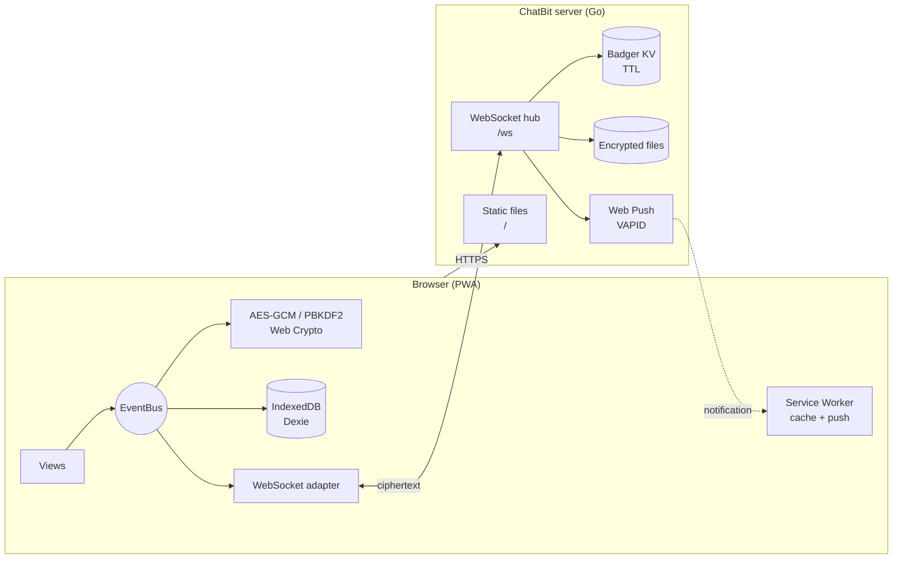
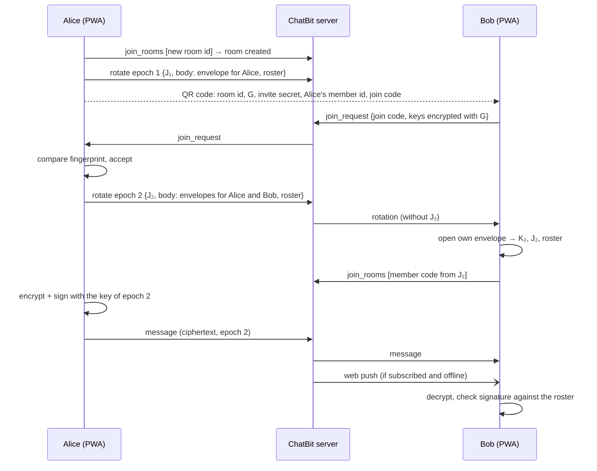
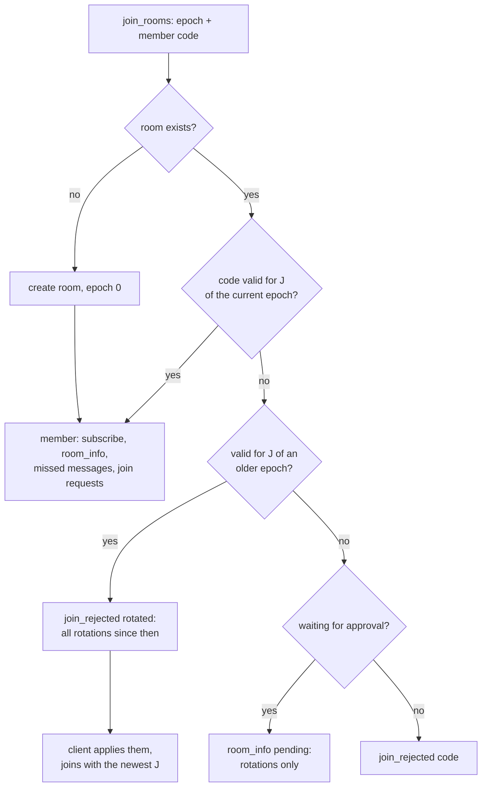
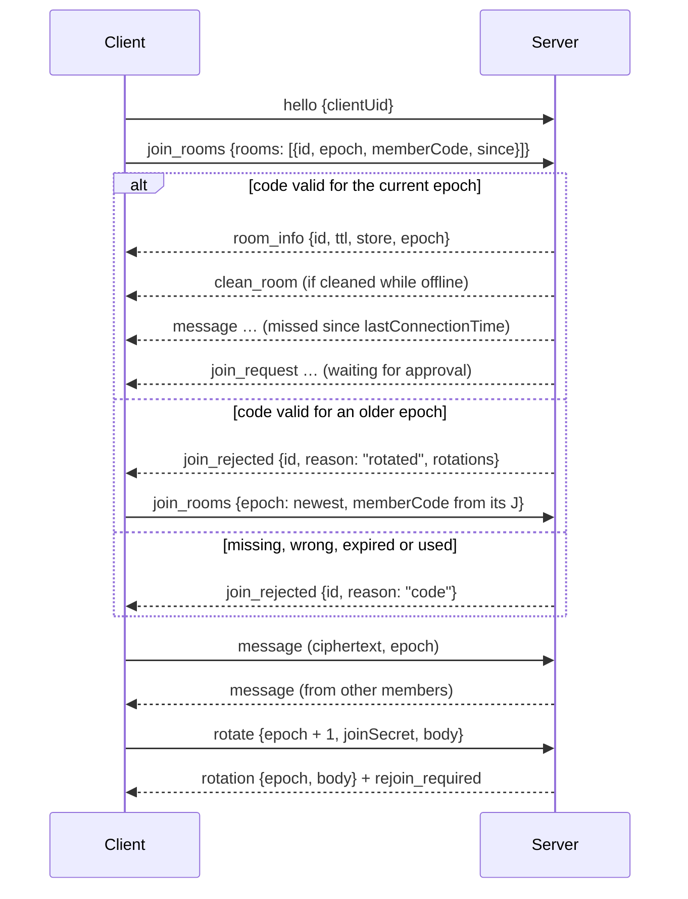

<p align="center">
  <picture>
    <source media="(prefers-color-scheme: dark)" srcset="dist/assets/img/LogoBenoni.svg">
    
  </picture>
</p>

# ChatBit

End-to-end encrypted group chat as a Progressive Web App.

**Try it:** [chatbit.ch](https://chatbit.ch) — a public test instance, no account needed.

[](https://github.com/benonich/chatbit/actions/workflows/ci.yml)
[](go.mod)
[](dist/manifest.json)
[](LICENSE)

ChatBit encrypts every message and image in the browser with AES-256-GCM before it leaves the
device. The Go server only relays and temporarily stores ciphertext — it never sees room keys,
member lists, message content, names or images. There are no accounts: a room is joined with an
invite QR code, and a member approves the join. Room keys change with every member change, so a
member who left can not read on.

## Table of Contents

- [Features](#features)
- [How It Works](#how-it-works)
- [Getting Started](#getting-started)
- [Configuration](#configuration)
- [Deployment](#deployment)
- [Project Structure](#project-structure)
- [WebSocket Protocol](#websocket-protocol)
- [Security Notes](#security-notes)
- [Roadmap](#roadmap)
- [License](#license)

## Features

- **End-to-end encryption** — AES-256-GCM with room keys that change in **epochs**
  ([docs/room-keys.md](docs/room-keys.md)): a new key for every member change and once a day,
  delivered to each member in its own envelope (HPKE, X25519)
- **Signed messages** — every message is signed by its sender (Ed25519); a message whose signature
  does not match the member it claims to come from is dropped. The name shown is the alias from the
  signed member list, fixed per room — not a name sent with the message
- **Member list with fingerprints** — every device knows who can read the room; fingerprints can be
  compared in person; any member can remove another one
- **Security page** — the lock chip in the room header ("E7 · 3": epoch and members) opens a page
  with the status of the room, how base key and epoch key work together, what to take care of
  (share invites in person) and what the server can and can not see
- **Key history** — room menu → Key history: a timeline of every key change (epoch) this device
  knows, with reason, who did it, the members with fingerprints, the hash chain and the number of
  messages per epoch. It is deleted together with the keys of an epoch
- **Message info and replies** — every message shows a "signed" mark; tap it to see the sender,
  its fingerprint and the signature, or reply to it. A reply signs the id of the message it
  answers; the quote is taken from the own copy of that message, never from the reply
- **No accounts** — local profile protected by a password (PBKDF2, 600 000 iterations)
- **Invite by QR code with approval** — the invite code (`CB3-…`, optionally protected with a PIN)
  contains no room key: whoever scans it can only *ask* to join, the inviter approves after comparing
  the fingerprint. The QR code can also be scanned with the native camera app and pasted
- **One-time invites** — every invite carries a join code that the server accepts **once** and only
  for 5–10 minutes; the share dialog shows a countdown and renews an expired code
- **Fast QR scanner** — native `BarcodeDetector` where available, zxing-cpp (WebAssembly) on iOS and Firefox
- **Images and documents** — any file, encrypted and uploaded in chunks over the WebSocket with retry
- **Store setting per room** — keep messages encrypted on the server for members who are offline,
  or deliver them only to members who are online right now (set once when the room is created)
- **Self-deleting messages** — every room has a maximum TTL that is set once when it is created and
  enforced by the server; single messages can be sent with a shorter TTL. Expired messages are
  deleted on the server and on every device (checked every minute), the remaining time is shown
  on each message. Images and other files live exactly as long as their message (at most 30 days).
- **Offline-capable PWA** — installable, cached app shell; a short notification appears when a new
  version was installed
- **Web Push** — notifications for new messages (VAPID)
- **Reliable connection** — automatic reconnect with exponential backoff, outbox for messages sent while offline
- **Transparent updates** — "Update App" first shows the installed and the available version
  (version, commit with link, build date and a hash over every file of the app) and only updates
  after confirmation. `task hash` (`chatbit -asset-hash`) gives the hash of a checkout, so anyone can
  check that a server delivers exactly the published code
- **Settings** — change the password, light / dark mode, storage usage with image clean up,
  delete all local data, app version info
- **Auto log off** — after 30 min, 2 h, 6 h or 12 h without interaction the keys are dropped from
  memory and the lock screen is shown (time in the background counts as well)

## How It Works



1. **Profile** — on first start the user picks an alias (used for new rooms; in a room it is fixed
   when the room is created or joined) and a password. A master key is derived
   with PBKDF2 and only kept in memory; all room secrets are stored in IndexedDB encrypted with it.
2. **Room** — creating a room generates a base key **G** and the device's key pairs (X25519 to receive
   keys, Ed25519 to sign). The first rotation starts epoch 1.
3. **Invite** — room id, name, G, a one-time invite secret, the inviter's member id and a one-time
   join code go into the QR code. G never passes through the server.
4. **Join request and approval** — the new device sends its public keys (encrypted with G, protected
   with the invite secret). The inviter compares the fingerprint and accepts: a **rotation** starts the
   next epoch.
5. **Rotation** — a new epoch key K and join secret J, sealed for every member in its own envelope,
   plus the signed member list. The server only checks that it is the next epoch and stores it; the
   room key of the epoch is `HKDF(K, G)` — the server has neither.
6. **Messages** — text and files are encrypted with the key of the current epoch and signed. The
   server only takes them from members of the current epoch (join code from J).
7. **Reconnect** — the client joins with a code of its newest epoch; if the room rotated meanwhile
   it gets the missed rotations first, then the missed messages.



The full design — threat model, keys, flows, formats, edge cases and known limits — is in
**[docs/room-keys.md](docs/room-keys.md)**.

### Join codes

Join codes prove to the server that a client may join a room, without the server ever seeing a
room key. They are derived from the join secret **J of the current epoch** with HMAC-SHA256 over a
5 minute time window and a random nonce (`internal/domain/joincode.go`, `dist/assets/js/adapter/join_code.js`).
Every rotation brings a new J — in the envelopes, so a removed member can not join anymore.

| Code        | Derived from                                   | Used by                                         |
|-------------|------------------------------------------------|-------------------------------------------------|
| invite code | `invite:<window>:<nonce>`                      | new members: one join request                   |
| member code | `member:<window>:<clientUid>:<nonce>`          | members on every (re)join, bound to their client id |



A code is accepted in the window before, during and after the current one (clock drift), so it
lives 5–10 minutes. Used codes are stored only as a hash of room id and code until they could
no longer be valid anyway.

## Getting Started

### Requirements

- [Go](https://go.dev/dl/) 1.27+
- [Task](https://taskfile.dev/) (optional, for builds with version info)
- Docker (optional)

### Run locally

```bash
git clone https://github.com/benonich/chatbit.git
cd chatbit
go run .
```

Open <http://localhost:8081>. On `localhost` the service worker does not cache anything, so
changes in `dist/` are visible after a reload.

The browser console only shows start, connection, warnings and errors. For debug logs (events,
room and file ids) run `localStorage.setItem("ChatbitDebug", "1")` in the console and reload.
Message content, names, keys and invite codes are never logged.

> Camera access (QR scanner), service workers and push notifications require a secure context.
> They work on `localhost`; on any other host ChatBit has to be served over **HTTPS**.

### Build

```bash
task build:app        # binary in artifacts/chatbit with version, commit and build date
```

### Tests

```bash
go test -race ./...
golangci-lint run      # config in .golangci.yml
task test:js           # room key crypto and protocol: node --test "tests/js/*.test.mjs" (no dependencies)
```

`dist/assets/js/lib/crypto-bundle.js` (HPKE X25519, Ed25519) is built from pinned versions by
`task build:crypto` (`tools/crypto-bundle`); CI checks that the checked in file is exactly that build.

## Configuration

| Variable            | Description                                                           | Default                  |
|---------------------|-----------------------------------------------------------------------|--------------------------|
| `VAPID_PUBLIC_KEY`  | Web Push public key. Must be set together with `VAPID_PRIVATE_KEY`.   | read from `vapid.json`   |
| `VAPID_PRIVATE_KEY` | Web Push private key. Must be set together with `VAPID_PUBLIC_KEY`.   | read from `vapid.json`   |
| `IMAGE_TMP_DIR`     | Directory for uploaded (encrypted) files.                             | `./files`                |
| `LOG_LEVEL`         | `debug`, `info`, `warn` or `error`. Client, room and message ids are only logged on `debug` — keep it off in production, logs are metadata. | `info` |

### Limits

Limits against abuse. The defaults are far above normal use; invalid values are logged and the
default is used.

| Variable                      | Description                                                              | Default |
|-------------------------------|--------------------------------------------------------------------------|---------|
| `MAX_CONNECTIONS`             | WebSocket connections in total                                           | `10000` |
| `MAX_CONNECTIONS_PER_IP`      | WebSocket connections per IP                                             | `20`    |
| `CONNECTS_PER_MINUTE_PER_IP`  | New connections per IP and minute (HTTP 429 above)                       | `30`    |
| `TRUSTED_PROXIES`             | IPs/CIDRs of reverse proxies whose `X-Forwarded-For` is trusted (comma separated, `none` = no proxy). Without it all clients behind the proxy share one IP. | `127.0.0.1/8,::1/128` |
| `MAX_ROOM_SUBSCRIBERS`        | Open connections per room                                                | `256`   |
| `MESSAGES_PER_SECOND`         | Messages per connection and second                                       | `5`     |
| `MESSAGE_BURST`               | Messages a connection may send at once before the rate applies           | `20`    |
| `MESSAGES_PER_SECOND_PER_IP`  | Messages per IP and second                                               | `20`    |
| `JOINS_PER_SECOND`            | Join / leave / create room / push subscription frames per connection and second | `2` |
| `MAX_ROOMS_PER_JOIN`          | Rooms in one `join_rooms` frame (more are cut)                           | `200`   |
| `ROOMS_PER_HOUR_PER_IP`       | New rooms per IP and hour                                                | `10`    |
| `ROOM_IDLE_DAYS`              | A room (with its member list) is deleted when nothing happened for its message TTL plus this many days | `30` |
| `MAX_UPLOADS_PER_CONNECTION`  | Parallel file uploads per connection                                     | `2`     |
| `UPLOAD_MB_PER_HOUR_PER_IP`   | Uploaded MB per IP and hour                                              | `500`   |
| `MAX_FILE_SIZE_MB`            | Largest file (encrypted size)                                            | `25`    |
| `MIN_FREE_DISK_MB`            | Uploads are refused when less disk space would be left                   | `1024`  |
| `PUSH_INTERVAL_SECONDS`       | At most one push per device in this interval — a burst of messages gives one notification | `30` |

A client that keeps sending above the message or join rate is disconnected after 100 dropped frames.
Push subscriptions are only accepted for the push services of the browsers (Google, Apple, Mozilla,
Microsoft), and push requests never go to private or local addresses.

VAPID keys are resolved in this order: environment variables → `vapid.json` in the working
directory → a newly generated pair, which is then saved to `vapid.json`. Keep the keys stable:
changing them invalidates all existing push subscriptions.

Generate a key pair once, e.g. with:

```bash
npx web-push generate-vapid-keys
```

Data written to the working directory:

| Path             | Content                                 |
|------------------|-----------------------------------------|
| `chatbit_db.kv/` | Badger database (messages, rooms, rotation log, join requests, push subscriptions, hashes of used join codes) |
| `vapid.json`     | Generated VAPID keys (if not set via env) |
| `files/`         | Uploaded encrypted files, one folder per room (if `IMAGE_TMP_DIR` is not set) |

The server listens on port **8081** (HTTP and WebSocket on `/ws`).

## Deployment

### Docker

```bash
docker buildx build \
  --build-arg BUILD_BASE_IMAGE=golang:1.27-alpine \
  --build-arg TARGET_BASE_IMAGE=alpine:3.24 \
  -t chatbit .

docker run -d -p 8081:8081 \
  -e VAPID_PUBLIC_KEY=... \
  -e VAPID_PRIVATE_KEY=... \
  -v chatbit-db:/app/chatbit_db.kv \
  -v chatbit-files:/app/files \
  chatbit
```

Mount only the data paths — a volume on `/app` would hide the binary and `dist/` of newer images.

### Reverse proxy

Run ChatBit behind a reverse proxy that terminates TLS and forwards WebSocket upgrades on `/ws`.
Example for nginx:

```nginx
# First line of defense, ChatBit checks its own limits as well
limit_req_zone  $binary_remote_addr zone=chatbit_ws:10m rate=30r/m;
limit_conn_zone $binary_remote_addr zone=chatbit_conn:10m;

server {
    # No access log: it would record IP, time and path of every client
    access_log off;

    location / {
        proxy_pass http://127.0.0.1:8081;
    }

    location /ws {
        limit_req  zone=chatbit_ws burst=10 nodelay;
        limit_conn chatbit_conn 20;

        proxy_pass http://127.0.0.1:8081;
        proxy_http_version 1.1;
        proxy_set_header Upgrade $http_upgrade;
        proxy_set_header Connection "upgrade";
        proxy_set_header X-Forwarded-For $proxy_add_x_forwarded_for;
        proxy_read_timeout 1h;
    }
}
```

If the proxy runs on another host or in another container, set `TRUSTED_PROXIES` to its address
(e.g. the Docker network `172.16.0.0/12`), otherwise all clients count as one IP.

### Updates

The service worker cache is named after the build commit. After deploying a new build, clients
install the new version in the background and show a short notification that disappears on its
own. "Update App" (home menu) shows the installed and the available version — commit, build date
and asset hash — before updating.

## Project Structure

```
.
├── main.go                     # entry point: message TTL, VAPID keys, server start
├── internal/
│   ├── core/                   # application wiring (DB, pub/sub)
│   ├── domain/                 # Message, Room, Peer, File, join codes, rotations, WebSocket message types
│   ├── port/                   # HTTP file server, WebSocket hub, room epochs (rooms.go), file transfer
│   ├── adapter/                # badger database, pub/sub, VAPID / web push
│   └── controller/store/       # generic KV store with TTL
├── dist/                       # the PWA (served as static files)
│   ├── index.html
│   ├── service-worker.js
│   ├── manifest.json
│   └── assets/
│       ├── js/
│       │   ├── app.js          # composition root
│       │   ├── adapter/        # aes, database, websocket, views, scanner, invite, join codes,
│       │   │                   # room_crypto + room_keys (epochs), log off, push, …
│       │   ├── domain/         # Message, Room, File, Profile
│       │   └── lib/            # Bootstrap, Dexie, qrcode.js, zxing-wasm, crypto-bundle
│       └── view/               # page templates (header/content)
├── docs/room-keys.md           # design of the room keys with epochs
├── tests/js/                   # node --test: room key crypto and protocol
├── tools/crypto-bundle/        # reproducible build of lib/crypto-bundle.js
├── api/openapi.yaml
├── Dockerfile
└── Taskfile.yml
```

## WebSocket Protocol

All frames on `/ws` are JSON with a `type` field; file chunks are sent as binary frames.



| Type               | Direction        | Purpose                                         |
|--------------------|------------------|-------------------------------------------------|
| `hello`            | client → server  | first frame of every connection: `{clientUid}` (not in the URL, so it is not in proxy logs) |
| `join_rooms`       | client → server  | subscribe to rooms with the epoch and a member code, request missed messages per room from `since` (server time of the newest message the device has, never its own clock); TTL and store setting are only used when the room is created |
| `join_rejected`    | server → client  | `code`: no valid join code; `declined`: join request declined; `rotated`: code of an older epoch — with all rotations since then |
| `room_info`        | server → client  | TTL, store setting and epoch of a joined room (`pending`: waiting for approval) |
| `room_synced`      | server → client  | all missed messages of the join are sent, up to `until` — the client moves its cursor of the room there |
| `join_request`     | both             | a new member asks to join (invite code + keys encrypted with G); passed on to the members |
| `answer_request`   | client → server  | a member approved or declined a join request: it is deleted; a declined requester is removed and gets `join_rejected {declined}` (also later, if it was offline) |
| `rotate`           | client → server  | start the next epoch: new join secret + encrypted body (envelopes, member list, signature) |
| `rotation`         | server → client  | an accepted rotation (without the join secret) |
| `rotate_rejected`  | server → client  | another rotation was first, or the sender is no member of the current epoch |
| `rejoin_required`  | server → client  | after a rotation: join again with a code of the new join secret |
| `key_update`       | both             | a member's new X25519 key (encrypted), kept until the next rotation |
| `message_rejected` | server → client  | the room rotated while the message was on its way — the client sends it again |
| `leave_rooms`      | client → server  | unsubscribe from rooms                          |
| `clean_room`       | both             | delete all messages and files of a room on the server (members only); forwarded to all members, offline members get it on their next join. The cleaner then sends a signed message (type 4) — everybody sees "Alice cleared the chat for everyone" |
| `create_room`      | client → server  | register a new room (never overwrites an existing one) |
| `message`          | both             | encrypted and signed message with its epoch (members of the current epoch only) |
| `sub_push`         | client → server  | store a web push subscription                   |
| `transfer_start`   | client → server  | start a chunked file upload                     |
| `transfer_ack` / `transfer_nack` | server → client | chunk / upload accepted or rejected   |
| `transfer_done`    | both             | upload finished                                 |
| `transfer_request` | client → server  | download an encrypted file                      |

## Security Notes

- The server only handles ciphertext, but it does see metadata: room ids, timestamps and which
  client is in which room. Messages and images are padded before encryption, so their
  size reveals little; the image type is encrypted as well. A shorter message TTL can only be one
  of a few fixed steps, so it does not mark the messages of one person.
- Messages and files can not be overwritten: the server only accepts ids that do not exist yet.
- **Room keys with epochs** ([docs/room-keys.md](docs/room-keys.md)): every member change (and once a
  day) starts a new epoch with a new key and a new join secret, sealed for each member separately
  (HPKE X25519). The room key of an epoch also depends on the base key G from the QR code, which never
  passes through the server — so the server can not read anything, also not with a future quantum
  computer. A member who left or was removed gets no new keys and can not even join the server anymore.
- **The member list is signed and chained:** every rotation is signed by a member of the previous
  epoch and contains the hash of the one before. The server can not add members or show different
  member lists unnoticed. Compare fingerprints in person to be sure who is who.
- **An invite code alone does not open a room:** it lets one device ask to join, the inviter approves.
  It still contains G, so **share invites in person (QR code)**; "Copy Code" over another messenger
  gives G to that service. A PIN helps only a little (short PINs can be brute forced).
- **Join codes** (HMAC of the join secret of the current epoch, 5 minute windows, random nonce) work
  **once** and expire after 5–10 minutes; used codes are kept as hashes until they expire.
- **Not covered:** forward secrecy per message (only per epoch — whoever steals an epoch key reads
  that epoch), a compromised device of a current member, and a removed member *together with* the
  server. The HPKE library (hpke-js) is not audited; noble (Ed25519, SHA-256) is.
- **Content Security Policy:** the server only allows scripts, styles, fonts and connections from its
  own origin (plus WebAssembly for the QR decoder) and sets `nosniff`, `no-referrer` and
  `frame-ancestors 'none'`. Injected HTML can not run code or send the keys anywhere. The app has no
  inline scripts or `on…` handlers; the Inter font is served locally instead of from Google Fonts.
- **Leaving a room** deletes everything of it on the device in one step: base key G, identity, the
  keys of all epochs, messages and files (IndexedDB and memory). The same happens when a join request
  is declined or expires. A member that was *removed* by someone else keeps its old epoch keys to read
  the old messages until it leaves the room itself.
- **Auto log off** drops the master key and room keys from memory; the data in IndexedDB stays
  encrypted with the password.
- The password protects the local profile. It cannot be recovered; forgetting it means losing
  access to the stored rooms on that device.

## Roadmap

- [ ] Online / offline status of users
- [x] Expiring and one-time invite codes (join codes)
- [x] Room access proof — only clients with a valid join code can join
- [x] Room key and join secret rotation (epochs), approval of new members, signed messages
- [ ] Device tests on iOS Safari / Android / Firefox for the room keys
- [ ] Several devices per person
- [ ] Configurable listen port
- [ ] Session ids instead of a fixed client id

## License

[MIT](LICENSE) © [Benoni](https://benoni.dev) · [chatbit.ch](https://chatbit.ch)
