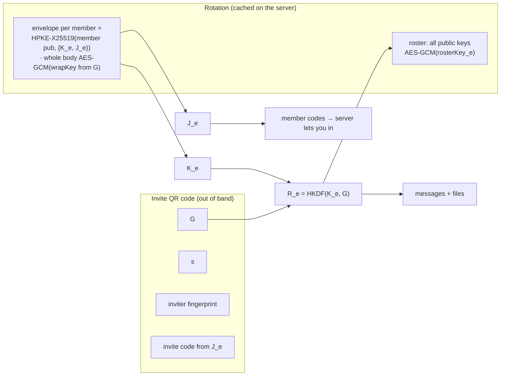
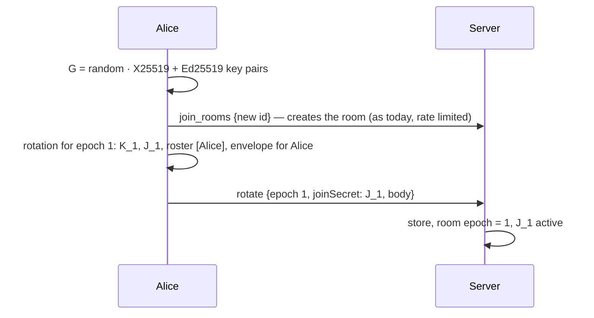
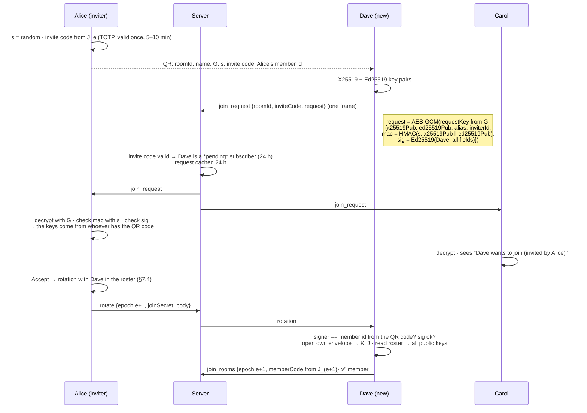
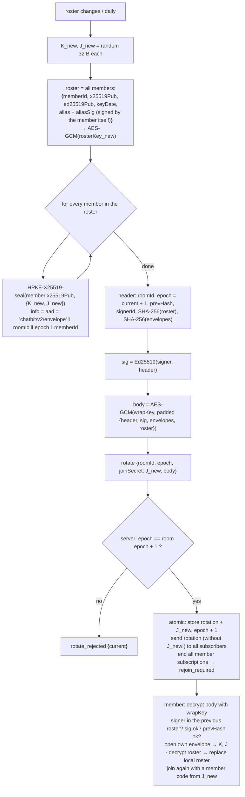
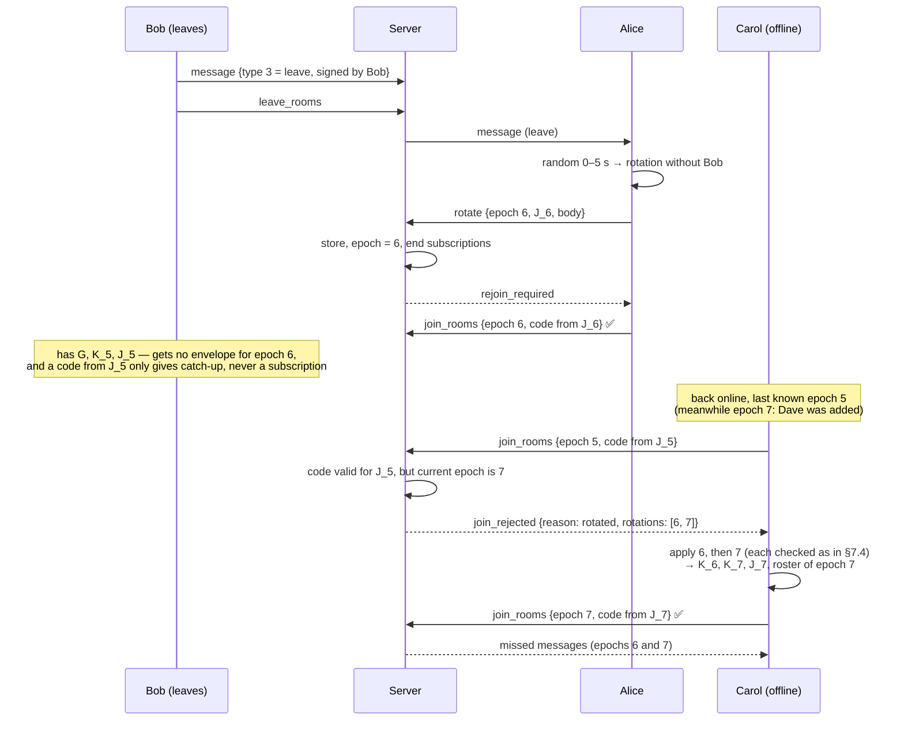
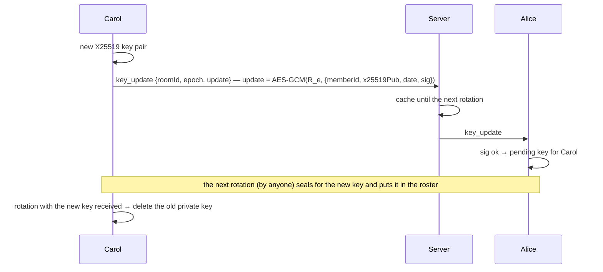
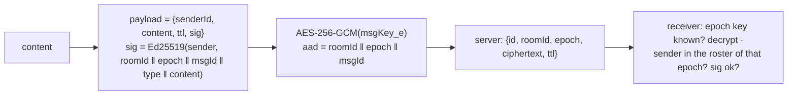

# Design: Room Keys with Epochs

| | |
|---|---|
| Status | **Implemented** (v2) — server `internal/port/rooms.go`, client `adapter/room_crypto.js` + `adapter/room_keys.js` |
| Date | 2026-10-27 |
| Replaces | the static room key in the invite code and the static join secret (see README → Security Notes) |

## 1. Why

Today a room has **one AES-256 key and one join secret for its whole life**, and the key is inside the
invite QR code.

| Problem today | Consequence |
|---|---|
| A member who leaves keeps the key and the join secret | can still join and read every future message |
| A photographed / forwarded invite code contains the key | the finder can read the room (the PIN only slows this down) |
| Only the server knows who is in a room — and only as `clientUid` | members can not see or check who reads along |
| The alias is set by the client, per message | any member can write under another member's name |

## 2. Goals and non-goals

**Goals**

- A removed or leaving member can not read **new** messages — and does not even get them anymore.
- A new member can not read **old** messages.
- An invite code alone is not enough to read a room — a member has to approve the join.
- Every member has the **signed list of all members** and their public keys; every message is **signed**.
- The server can never read anything — **at least as strong as today**, also against quantum computers.
- Simple enough to be fully understood and tested by us (no full group protocol like MLS).

**Non-goals** (see [§12](#12-known-limits))

- Forward secrecy per message (only per epoch).
- Automatic healing of a compromised device before the next rotation.
- Multiple devices per person (each device is its own member).

## 3. Threat model

| Attacker | Can | Must not be able to |
|---|---|---|
| **Server** (malicious or hacked) | read, drop, delay, reorder, replay all frames; swap public keys | read content, add itself as a member, give members different member lists unnoticed |
| **Network recorder + future quantum computer** | store everything today, break X25519 later | decrypt it |
| **Former member** | keeps everything it had (G, old epoch keys, old join secrets) | get or read anything sent after its removal |
| **Finder of an invite code** | knows G, s and a join code | read the room without being approved |
| **Current member** (malicious) | everything a member can | write in the name of another member |

Out of scope: a compromised device of a current member, XSS in the app (→ CSP), a member who leaks
plaintext, a former member **together with** the server.

## 4. Keys

| Key | Type | Who has it | Comes from | Purpose |
|---|---|---|---|---|
| **G** — base key | symmetric, 32 B | all members, also former ones | invite QR code, **never via the server** | keeps the **server** and recorders out |
| **K\_e** — epoch key | symmetric, 32 B | members of epoch *e* | envelope of the rotation | keeps **former members** out (crypto) |
| **J\_e** — join secret | symmetric, 32 B | members of epoch *e* + server | envelope of the rotation | the server lets only members of epoch *e* in (TOTP codes) |
| **R\_e** — room key | symmetric, AES-256 | members of epoch *e* | derived: `HKDF(K_e, G)` | encrypts messages, files, the roster |
| **X25519** key pair | asymmetric (ECC) | public: members, private: own device | generated on the device, per room | receive envelopes |
| **Ed25519** key pair | asymmetric (ECC) | public: members, private: own device | generated on the device, per room | prove authorship |
| **s** — invite secret | symmetric, 16 B | inviter + invitee | invite QR code | protects the join request against key swapping |
| Master key | symmetric | own device, memory only | password (PBKDF2, unchanged) | protects all keys above in IndexedDB |

- Key pairs are **per room**, so members of two rooms can not be linked by their keys.
- **Member id** = first 16 bytes of `SHA-256(ed25519_pub)`, the fingerprint shows its first 8 bytes
  (e.g. `7F3A 19C2 0B5E 44D1`). The Ed25519 key never changes, so neither does the member id.
- The server **never** learns member ids or public keys. `clientUid` stays what it is today: the address of
  a connection.

### 4.1 Lifetimes

There are **no certificates** (no X.509, no expiry date).

| Key | Lifetime | Renewal |
|---|---|---|
| G | the room's life | never (it is what the QR code carries) |
| K\_e, J\_e, R\_e | one epoch | every rotation ([§7.4](#74-rotation)) |
| Ed25519 | the membership | never — a new identity means leaving and a new invite |
| X25519 | short | by the member: with every own rotation, at least every 30 days ([§7.6](#76-renewing-the-x25519-key)) |
| s | one invite | — |

### 4.2 Derivations

All HKDF are HKDF-SHA-256 (WebCrypto). `‖` = concatenation, ids as raw bytes, epoch as u32 big endian.

```
R_e        = HKDF(ikm = K_e, salt = G, info = "chatbit/v2/room"    ‖ roomId ‖ epoch)
msgKey_e   = HKDF(ikm = R_e, salt = 0, info = "chatbit/v2/message")
fileKey_e  = HKDF(ikm = R_e, salt = 0, info = "chatbit/v2/file")
rosterKey_e= HKDF(ikm = R_e, salt = 0, info = "chatbit/v2/roster")
wrapKey    = HKDF(ikm = G,   salt = 0, info = "chatbit/v2/wrap"    ‖ roomId)
requestKey = HKDF(ikm = G,   salt = 0, info = "chatbit/v2/request" ‖ roomId)
```

Join codes are derived from J\_e exactly like today's join codes from the join secret
(`internal/domain/joincode.go`, `adapter/join_code.js`): HMAC over a 5 minute window and a nonce, valid once.

## 5. Why ECC (X25519) is enough

The envelopes use X25519, which a large quantum computer could break. That is acceptable because every
attacker needs more than the envelope:

| Attacker | breaks X25519 → K\_e | has G | gets the ciphertext | reads |
|---|---|---|---|---|
| Server / recorder | ✅ (future) | ❌ never via the server | ✅ | ❌ — `R_e = HKDF(K_e, G)` |
| Former member | ✅ (future) | ✅ | ❌ no J\_e → no join, no rotations with an envelope, no messages | ❌ |
| Former member **+ server** | ✅ | ✅ | ✅ | ⚠️ out of scope |

G is used with AES-256 / HKDF-SHA-256, which stay secure against quantum computers. This holds **only as
long as G does not pass through third parties** — see [§12](#12-known-limits).

## 6. Libraries

| Use | Library | License | Assurance |
|---|---|---|---|
| HPKE (RFC 9180): DHKEM-X25519-HKDF-SHA256, HKDF-SHA256, AES-256-GCM | `@hpke/core` 1.9.0 (+ `@hpke/dhkem-x25519` 1.8.0 where WebCrypto has no X25519) | MIT | RFC 9180 + Wycheproof test vectors, not audited |
| Ed25519 signatures | `@noble/curves` ≥ 2.3.0 | MIT | **audited** (Trail of Bits 2026, Cure53 2024) |
| AES-256-GCM, HKDF, SHA-256, HMAC, random | WebCrypto | browser | native |

Bundled once with esbuild into one file in `dist/assets/js/lib/` (like Dexie and zxing), versions pinned,
sha512 noted in the file header. **Must be tested on iOS Safari.**

## 7. Flows

### 7.1 Overview



| Who | has G | opens an envelope | gets in (J\_e) | reads epoch *e* |
|---|---|---|---|---|
| member of epoch *e* | ✅ | ✅ | ✅ | ✅ |
| server | ❌ | ❌ | (knows J\_e) | ❌ |
| former member | ✅ | ❌ no envelope for it | ❌ | ❌ |
| finder of the QR code | ✅ | ❌ not approved | only as "waiting" | ❌ |

### 7.2 Create a room



Creating is just the first rotation — one code path for both. Until epoch 1 exists the room has no join
secret and nobody else can join. Only the connection that created the room may send epoch 1.

### 7.3 Invite and join (with approval)



- **Only the inviter can approve**: only the inviter knows `s`, and Dave can only check the signature of the
  member id that is in his QR code. Other members see the request but can not accept it (Q1).
- While pending, Dave's app shows **"waiting for approval"**. As a pending subscriber he gets ciphertext,
  but no envelope → he can read nothing.
- A rotation in between makes the invite code invalid (new J) → the share dialog creates a new one. An
  already sent `join_request` stays valid (it is cached by room, not by J).
- With his first rotation Dave gets the **complete roster** — he can do the next rotation himself.

### 7.4 Rotation

A rotation happens when a member is added, leaves or is removed, and once a day (Q2).



- **One atomic frame.** Envelopes, roster and the new join secret arrive together; the server stores
  the rotation and switches J in one step — there is no half rotated room.
- **J\_new goes twice:** in clear for the server (it must check the codes) and inside every envelope for the
  members. The server **never forwards J in clear** — it strips it from the `rotation` it sends on.
- **The roster is always complete** (snapshot, no diffs). Every client replaces its local roster with the one
  from the newest rotation. The newest rotation on the server *is* the current member list — it can not
  get out of sync, and a new member gets all public keys at once.
- **The server sees only** `roomId`, `epoch`, `J_new` and the size. Member ids, signer, envelopes and roster
  are encrypted with `wrapKey` (from G). The body is padded to a multiple of 2 KB, so the size hints less
  at the number of members.
- **Everyone gets all envelopes** and finds its own by its member id. With X25519 an envelope is ~80 B —
  not worth addressing them one by one (which would tell the server who is who).
- **rejoin\_required:** after a rotation the server ends all *member* subscriptions of the room. Members
  join again with a code from J\_new; a removed member can not, even if it is connected right now. Pending
  subscriptions (invite code, < 24 h) are kept, so a waiting Dave still gets the rotation that adds him.
- **Chain:** `prevHash` = SHA-256 of the previous rotation's header. A client only accepts epoch *e+1* if it
  builds on the epoch *e* it knows → the server can not give members different histories unnoticed.
- **Two rotations at once:** the server takes the first one (`epoch == current + 1`); the other client gets
  `rotate_rejected`, applies the winner and redoes its change if it is still needed. Leave and kick
  rotations wait a random 0–5 s first, so usually only one member sends.

**Size** (X25519, per member: envelope ~80 B + roster entry ~135 B):

| Members | Rotation |
|---|---|
| 10 | ~2 KB |
| 50 | ~11 KB |
| 200 | ~43 KB |

### 7.5 Leave, remove and offline members



- **Leave:** the leaving member sends a signed leave message, then `leave_rooms`. Until a rotation without
  it is done, the others show "Bob is leaving…" and do not send.
  On its own device, leaving deletes the room with G, the identity, the keys of all epochs, messages
  and files right away (`RoomKeys.deleteLocal`, also used for a declined or expired join request).
  Messages that still arrive for the room are dropped.
- **Remove (kick):** a member sends a rotation without the removed member (who may do this → Q1). The
  removed member is thrown out by `rejoin_required` even while connected.
- A member that disappears without a leave message (app deleted) stays in the roster until someone removes
  it. The member list shows the key age ("key 45 days old") to make this visible.
- **Offline members need every rotation**, not only the newest: messages of epoch 6 need K\_6, and rotation 7
  can only be checked with the roster of epoch 6. That is why `join_rooms` carries the client's epoch.
- **Old codes only allow catch-up.** A code from an old J (still in the rotation log) gives
  `join_rejected {rotated, rotations}`, never a subscription. A former member can fetch those rotations too,
  but finds no envelope for itself — they are useless to it.
- If a needed rotation has already expired on the server, the client can not continue → "you were offline
  too long, please ask for a new invite".

### 7.6 Renewing the X25519 key

Whoever steals a member's X25519 private key can open every future envelope of that member (still
without G it is useless to the server). Renewing limits this:



- **When:** with every own rotation and at least every 30 days (Q7). No hard expiry: a member that was
  offline for weeks would otherwise get no envelope and be locked out.
- A rotator always uses the **newest signed** key of a member.

### 7.7 Messages and files



- Sign **then** encrypt: the server does not learn who sent a message.
- **The name is not in the message.** The receiver looks up `senderId` in the roster of the
  message's epoch, checks the signature with *that* member's key and shows *its* alias. A message
  whose signature does not fit is **dropped** (not stored, not shown) — nobody can write under the
  id or the name of another member.
- Two members with the same alias are told apart by the start of their fingerprint ("Bob · 3F2A").
- **Replies** carry `reply` = the id of the answered message, encrypted like the content and
  signed with it (appended to the signed fields only when set). The receiver shows the quote from
  its own copy of that message — a reply can not put words into someone else's mouth or be moved
  under another message.
- Every shown message carries a "signed" mark (shield) — messages with an invalid signature are
  never shown.
- Messages of an epoch the client does not know yet are kept and shown after the rotation arrived.
- Files: encrypted with `fileKey_e`; the file message carries the epoch. Upload and chunks unchanged.
- Old epoch keys are kept as long as messages of that epoch can exist (room TTL) → history stays readable.
- A system message in the chat for every rotation: "Alice added Dave", "Bob left", "Alice removed Eve".

### 7.7b Key history

Each epoch keeps, sealed with K and J, the parts of its rotation header that are not in the roster:
`meta = {reason, signerId, subject, prevHash}`. `RoomKeys.history()` turns the stored epochs into
the timeline of the room menu ("Alice removed Bob", members, `prevHash → headerHash`, messages
per epoch). It only covers the epochs this device has — from its own join on, and as long as the
keys are kept (Q3); epochs stored before the history existed show the member changes instead.

### 7.8 Alias: fixed per room

The alias is chosen once per room — the profile alias when the room is created or joined — and can
not change while the member is in the room. The profile alias is only the suggestion for new rooms.

- The member signs its alias itself: `aliasSig = Ed25519(member, 'chatbit/v2/alias' ‖ roomId ‖ alias)`
  (at most 64 characters). It travels in the join request and stays in the roster entry.
- Whoever writes a roster can not rename anyone: `openRotation` rejects a roster in which a member of
  the previous epoch has another alias, or a new member's alias does not match its own signature.
- Rosters from before the signed alias (no `aliasSig`) are accepted while the alias stays the same;
  every member adds its signature with its next own rotation.
- What a rotator *can* do is add a member — e.g. a second "Alice" with its own keys. Members with the
  same alias get the fingerprint suffix, and the approval dialog shows the fingerprint.

## 8. Formats

Binary fields are base64url in JSON frames. Signatures and MACs are computed over a **fixed byte
encoding** (fields in the listed order, each `u32 length ‖ bytes`), never over JSON text.

### 8.1 Invite code v2

Same compact code as today (`CB1-…` → `CB2-…`), optionally encrypted with a PIN (unchanged):

| Field | Size |
|---|---|
| roomId | 16 B |
| G | 32 B |
| s | 16 B |
| inviter member id | 16 B |
| invite code (from J\_e) | ~22 B |
| room name | ≤ 64 B |

No room key and no join secret anymore — only what is needed to *ask* to join.

### 8.2 WebSocket frames

| Type | Direction | Data |
|---|---|---|
| `join_rooms` | client → server | rooms `[{id, epoch, memberCode \| inviteCode, since}]` — `since`: missed messages per room (server time), followed by `room_synced {id, until}` |
| `join_rejected` | server → client | `{id, reason: "code" \| "rotated", rotations?: [{epoch, body}]}` |
| `room_info` | server → client | `{id, ttl, store, epoch}` — **no join secret anymore** |
| `join_request` | both | `{roomId, inviteCode?, request}` — cached 24 h, sent to members on join |
| `answer_request` | client → server | `{roomId, request, approved}` — approved: request deleted; declined: requester removed from the pending peers and told with `join_rejected {declined}` (right away or on its next join) |
| `rotate` | client → server | `{roomId, epoch, joinSecret, body}` |
| `rotation` | server → client | `{roomId, epoch, body}` — never with `joinSecret` |
| `rotate_rejected` | server → client | `{roomId, epoch, current}` |
| `rejoin_required` | server → client | `{roomId, epoch}` |
| `key_update` | both | `{roomId, epoch, update}` — cached until the next rotation |
| `message` | both | + `epoch`, `sig` (encrypted); only from members of the current epoch, with its key |
| `message_rejected` | server → client | `{id, roomId, reason}` — the room rotated while the message was on its way; the client sends it again |

## 9. Server changes

| What | Detail |
|---|---|
| Room | + `epoch` (u32); the join secret is no longer created by the server but set by the rotations |
| Rotation log | per room: `{epoch, joinSecret, body}`, kept as long as the room's messages (room TTL; max raised to 6 months) |
| Join codes | member code: checked against J of the claimed epoch. Current epoch → subscribe; older epoch in the log → `join_rejected {rotated, rotations since}` |
| Ordering | accept `rotate` only if `epoch == room.epoch + 1` (atomic, like used join codes); epoch 1 only from the creating connection |
| After a rotation | strip `joinSecret`, forward the rotation to all subscribers, end all member subscriptions, send `rejoin_required` |
| Pending subscribers | joined with an invite code: kept 24 h across rotations, get rotations and join requests, nothing else changes |
| Join requests / key updates | cached per room (24 h / until the next rotation) |
| **No key list** | the server stores **no public keys and no member list** — only the subscribers per room (`clientUid`, for routing, as today) and opaque blobs |
| Unchanged | the server never checks signatures — it can not, and does not need to: it only orders and checks join codes |

## 10. Client changes

| Module | What it does |
|---|---|
| `lib/crypto-bundle.js` | hpke-js (X25519 in pure JS) + noble Ed25519 / SHA-256, built reproducibly by `tools/crypto-bundle` |
| `adapter/room_crypto.js` | key pairs, envelopes, rotation build / verify, join request, key update, derivations, message signatures — no DOM, no DB |
| `adapter/room_keys.js` | the protocol: create, join by invite, apply / send rotations (one queue per room), catch-up, rejoin, approval, leave / remove, periodic rotation, key renewal, encrypt / check messages, resend after `message_rejected`, system messages |
| `adapter/key_store.js` | room base `{G, inviterId, identity, invites}` and epochs `{K, J, roster}`, encrypted with the master key; join entries and invite codes |
| `adapter/database.js` | schema v3: table `epoch` (`[roomId+epoch]`); rooms have `status` (pending / member / removed), `epoch`, `base` |
| `adapter/invite.js` | invite code v3 (`CB3-`) — no room key anymore |
| `adapter/websocket.js` | new frames, epoch + member code per room when joining |
| `adapter/view_home.js`, `view_room.js`, `view_approval.js` | "waiting for approval", approval dialog (any page), member list with fingerprints and key age, remove, system messages |

Messages: `aliasId` (the member id), `content` and `sig` are encrypted with the message key of the
epoch; `epoch` is in clear. There is no `alias` anymore — see 7.8. A file message carries the SHA-256 of
the encrypted file in its signed content — the receiver checks it, so nobody can swap a file on the server.

**Migration:** none. Alpha → all existing rooms are deleted on the server and on the clients with the update.

## 11. Edge cases

| Case | Handling |
|---|---|
| Two rotations for the same epoch | server takes the first; the other client gets `rotate_rejected`, applies the winner, redoes its change if still needed |
| Replay of an old rotation | rejected by the server (epoch) and by clients (epoch must be current + 1, `prevHash` must match) |
| Server swaps a public key in a join request | `mac` with `s` fails → "invalid request", not offered for approval |
| Server forwards J in clear by mistake / on purpose | only lets people *connect*; without G and an envelope they can read nothing |
| Message from a removed member | rejected: sender not in the roster of the message's epoch |
| Message with a future epoch | kept until the rotation arrives |
| Inviter offline after Dave's request | request waits 24 h; Dave sees "waiting for approval" |
| Inviter declines | the request is not shown again (also not after the next login); Dave is told and the room is removed on his device |
| Invite code becomes invalid by a rotation before it was scanned | Dave gets `join_rejected {code}` → "ask for a new invite" |
| Only the leaving member is online | the next member that comes online does the rotation; until then nobody sends anyway |
| Last member leaves | no rotation; the room is deleted by the server as today |
| Rotation whose roster does not contain the signer of the previous epoch's roster | refused — signer must be in the previous roster |
| Needed rotation expired on the server | "offline too long" → new invite |
| Key update from a removed member | ignored: signer not in the current roster |

## 12. Known limits

- **G must not pass through third parties.** The protection against the server and against recorders with
  a future quantum computer rests on G. Scanning the QR code in person is fine; sending the invite with
  "Copy Code" over another messenger or e-mail hands G to that service (as today with the room key). A PIN
  helps only a little (short PINs can be brute forced offline).
- **No forward secrecy per message:** whoever steals K\_e reads the whole epoch *e* → daily rotation.
- **No automatic healing:** a compromised device reads along until it is removed.
- A former member **together with** the server can get the ciphertext and, with a future quantum computer,
  break the X25519 envelopes (it has G).
- A **malicious member** that rotates could leave someone's envelope out. That member notices (it can not
  decrypt) and the rotation is signed, so the culprit is known.
- hpke-js is **not audited** (test vectors only); noble is.
- A member that leaves while it is **offline** can not send its leave message — it stays in the member list
  until someone removes it (the key age in the member list shows inactive members).
- The server can not tell a removed member from an offline one: a removed member keeps getting "new
  message" push notifications (no content) until it leaves or was offline for 7 days.
- A text message that was on its way during a rotation is sent again in the new epoch automatically; an
  image or document has to be sent again by the user.

## 13. Tests

| What | Where |
|---|---|
| Crypto: envelopes, wrong G / epoch / chain, forged rotations (signer not a member, fake removal), tampering, join request with swapped keys, key update, message signatures, key derivation | `tests/js/room_crypto.test.mjs` |
| Protocol with 3 clients and a fake server: create, invite + approval, signed messages, kick while connected, offline catch-up, concurrent rotations, resend after a rotation, leave, system messages | `tests/js/room_keys.test.mjs` |
| Server: epochs, creator-only epoch 1, pending peers, invite code once, catch-up with old codes, old code not good for the new epoch, concurrent rotations, backlog of join requests, key updates | `internal/port/rooms_test.go`, `internal/domain/*_test.go` |

`task test:js` / `go test ./...`. The same client modules were also run end to end against the Go
server over WebSockets. Still to test on devices: iOS Safari, Android Chrome, desktop Firefox.

## 14. Decisions

| # | Question | Decision |
|---|---|---|
| Q1 | Who may approve joins and remove members? | approve: the inviter (technically required, §7.3); remove: every member |
| Q2 | Periodic rotation? | daily, by the first member online after 24 h |
| Q3 | How long are old epoch keys kept on the device? | as long as messages can exist (room TTL), then deleted |
| ~~Q4~~ | Maximum group size? | dropped — with X25519 a rotation for 200 members is ~43 KB |
| Q5 | Compare fingerprints (safety numbers) in the room info? | yes, as short code + QR |
| Q6 | What does Dave see while waiting, what if nobody approves? | "waiting for approval"; the request expires after 24 h → new invite |
| Q7 | How often is the X25519 key renewed? | with every own rotation and at least every 30 days, no hard expiry |
